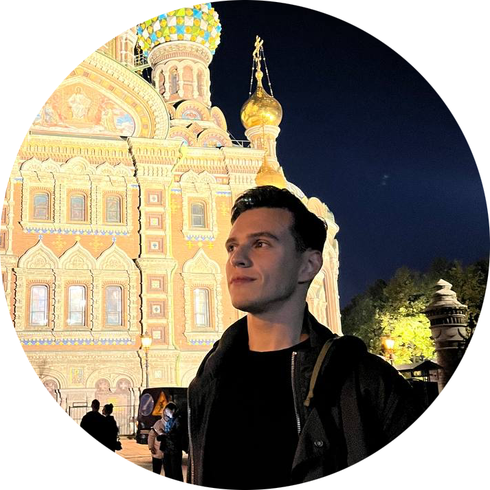

# О себе:

1) Меня зовут Александр. 
2) Мне очень нравится учится в Нетологии и я благодарен ее команде за возможность стать ближе к своей мечте. 
3) Имею два высших образования: филологическое и в сфере современных ИКТ технологий в образовании. 
4) Работаю преподавателем в педагогическом университете. 
5) Хотел бы научиться разрабатывать нейросети и разбираться в машинном обучении :)

## Интересный факт
* В 2025 году в рамках учебы прошел курсы повышения квалификации Университета науки и технологий МИСИС «Введение в инженерию больших данных»